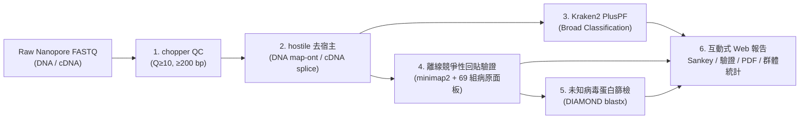

# ClinMeta — 全離線臨床 Nanopore 病原體宏基因體分析平台


**ClinMeta** 是一套專為臨床檢體（DNA + cDNA 雙庫或單庫）設計的 **100% 離線** Nanopore 宏基因體（mNGS）病原體檢測與驗證平台。從原始定序序列（FASTQ）出發，整合序列品管、人類宿主移除、物種分類、競爭性參考基因組回貼驗證、未知病毒遠緣篩檢與互動式 Web 視覺化報表，全程無須網際網路連線即可獨立運作。

---

## 分析流程架構



---

## 核心功能特色

### 1. Web 操作介面與 FIFO 平行排程 (`webapp/`)
- **總覽與離線環境監控**：即時顯示 CPU 核心數、可用記憶體、平行上限、已完成／執行中／排隊數，並檢查各離線資料庫就緒狀態（含 69 組 **Offline Pathogen Panel** 參考基因組表列清單檢視與下載）。
- **多樣本掃描與自選目錄送件**：支援自動掃描外掛輸入目錄（`<sample_id>/dna/*.fastq.gz`、`<sample_id>/cdna/*.fastq.gz`），或透過系統檔案瀏覽器手動選取 FASTQ 目錄／檔案加入排程，並可調整優先順序、重試、取消與刪除。
- **資源動態優化器 (`scripts/resource_optimizer.py`)**：依據主機即時 CPU 核心數、可用 RAM 與 `/dev/shm` 空間動態分配平行 Worker 數與每個任務的 `CPU Threads`，並自動啟用 Kraken2 `--memory-mapping` 與暫存索引加速。

### 2. 四維度單一樣本詳細報告
1. **全序列 Sankey 判定圖 (`read_disposition_sankey.html`)**：追蹤 100% 原始 reads 從 QC、去宿主到病原體／背景／人為產物（TSO/SSP concatemers）的互斥歸屬；提供 **顯示範圍（全部 vs 僅非人類）**、**縮放模式（冪次／對數／線性）**、**標籤切換（Reads／百分比）** 與 **SVG 匯出**。
2. **病原體競爭性回貼驗證報告 (`pathogen_validation_report.html`)**：提供 KPI 摘要卡片、覆蓋廣度視覺化長條圖與驗證總表，區分真實病原體與低品質交叉比對偽陽性。
3. **Kraken2 分類互動報告 (`kraken2/report.html`)**：內嵌離線版 Plotly，提供 QC 長條圖、分類佔比圖、分類層級 Sankey、物種熱圖與可搜尋／排序的物種明細表（標記常見試劑污染屬）。
4. **快速閱讀卡片與未知病毒篩檢**：摘要卡片搭配可點擊表頭排序的互斥判定表與 DIAMOND 遠緣病毒搜尋結果。
- 支援一鍵 **「下載完整報告 PDF」**（彙整四大報告區塊為 A4 列印版面）。

### 3. 批次群體篩選與統計報表
- 支援依關鍵字、日期區間、檢體類型、檢出病原與狀態進行篩選與分頁檢視。
- **Sample ID 自動去重**：預設同一 `Sample ID` 僅採計最新一筆分析結果，避免重複送件影響陽性率與流行病學統計（可手動切換關閉）。
- **群體視覺化統計報表（彈出預覽視窗）**：包含 **主要檢出病原體 Pie Chart**、**檢體類型 Pie Chart**、**特定病原隨時間檢出頻度趨勢圖** 與明細表，並支援 **CSV / TSV / HTML / PDF** 匯出。

---

## 快速啟動

### 方式一：使用 Docker / Docker Compose（推薦）

已建置映像檔：`lsbnb/cdc-nanopore-offline:latest`

```bash
# 拉取映像檔
docker pull lsbnb/cdc-nanopore-offline:latest

# 或使用 docker-compose 啟動（預設埠 8080）
docker compose up -d
```

啟動後開啟瀏覽器前往：`http://localhost:8080`

### 方式二：本機 Conda 環境執行

```bash
# 1. 建立離線環境（首次使用）
bash scripts/setup_environment.sh

# 2. 啟動 Web 平台（範例埠號 8088）
PATH="$PWD/.conda/envs/nanopore/bin:$PATH" CDC_PORT=8088 \
  python3 webapp/server.py
```

啟動後開啟瀏覽器前往：`http://localhost:8088`

### 方式三：命令列執行單一樣本

```bash
PATH="$PWD/.conda/envs/nanopore/bin:$PATH" \
  python3 scripts/run_offline_sample.py \
  --sample-id sample_001 \
  --dna-path input_samples/sample_001/dna \
  --cdna-path input_samples/sample_001/cdna \
  --specimen-type respiratory \
  --threads 16 \
  --outdir output_results/sample_001
```

---

## 離線資料庫與參考目錄規範

| 目錄 | 用途與內容 |
| :--- | :--- |
| `databases/kraken2/k2_pluspf_20261022/` | Kraken2 PlusPF 資料庫（細菌、病毒、古菌、真菌、原蟲、人類與 UniVec_Core） |
| `databases/diamond/viral_refseq_prot.dmnd` | NCBI Viral RefSeq 蛋白資料庫（DIAMOND 索引，用於未知病毒篩檢） |
| `references/human-masked.*` | Hostile 官方人類去宿主索引（含 DNA `map-ont` 與 cDNA `splice`） |
| `references/pathogen_panel/` | 離線臨床病原體面板（69 組細菌、病毒、真菌參考基因組及 `PANEL_CATALOG.tsv/.md`） |

---

## 專案目錄結構

```text
CDC_clinical/
├── Dockerfile                    # 容器建置檔 (micromamba + bioinformatics tools)
├── docker-compose.yml            # Docker Compose 掛載與環境設定
├── environment.yml               # Conda 工具規格
├── batch_dehost.sh               # 多批次平行品管與去宿主腳本
├── scripts/
│   ├── run_offline_sample.py     # 單一樣本全離線分析主流程與報告生成
│   ├── resource_optimizer.py     # CPU / RAM / Page-Cache 動態資源優化器
│   ├── kraken2_report_html.py    # 離線互動式 Kraken2 Plotly HTML 報告生成器
│   ├── generate_sankey_report.py # 互動式全序列 Sankey 判定圖生成器
│   ├── generate_validation_outputs.py # 競爭性回貼驗證報告與共識序列輸出
│   ├── generate_demo_datasets.py # 測試／展示用離線樣本資料生成器
│   └── vendor/plotly-4.3.0.min.js # 內嵌離線版 Plotly.js
└── webapp/
    ├── server.py                 # Web API、FIFO 排程佇列與報表匯出服務
    ├── index.html                # 前端互動介面
    └── assets/                   # ClinMeta Logo 資源
```
